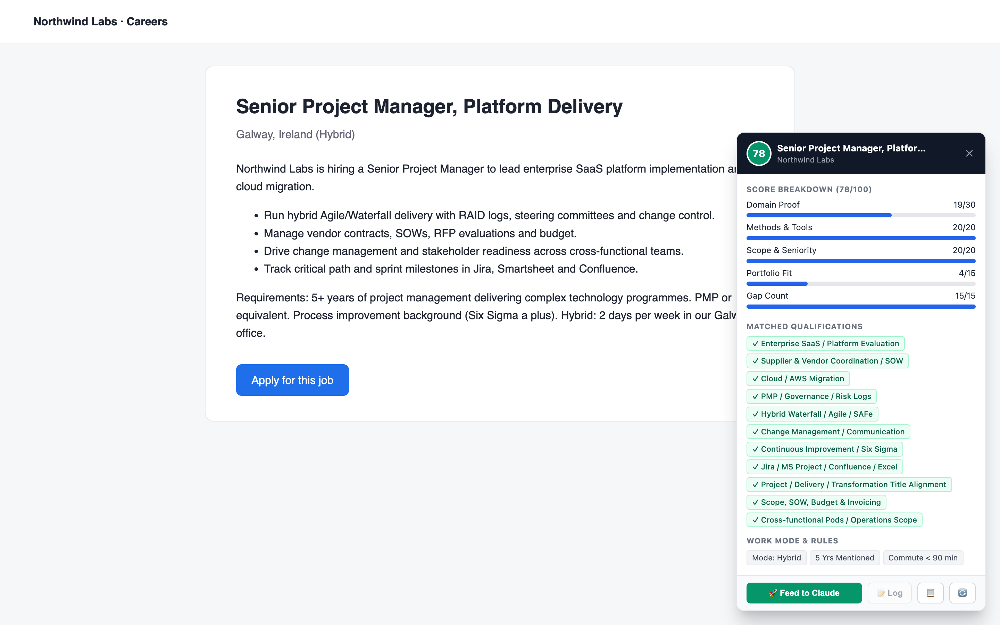
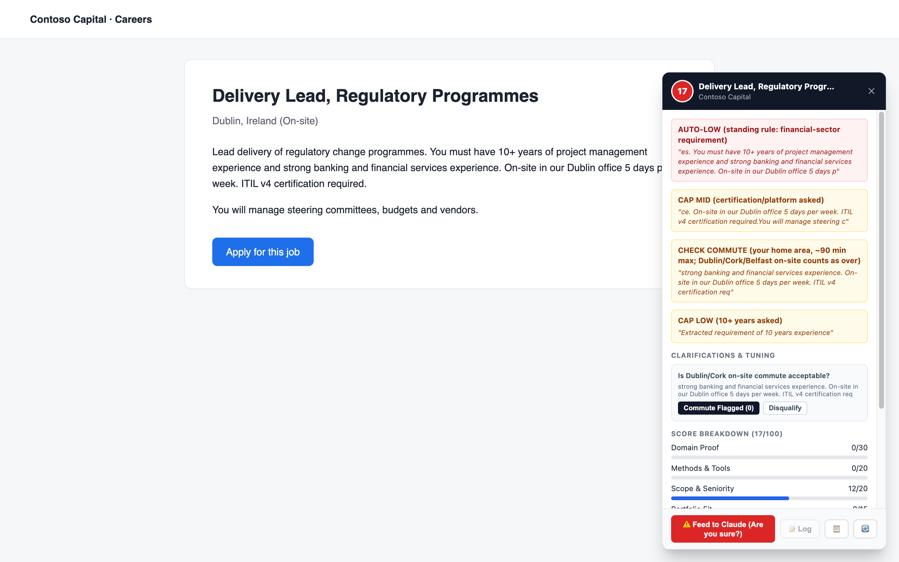
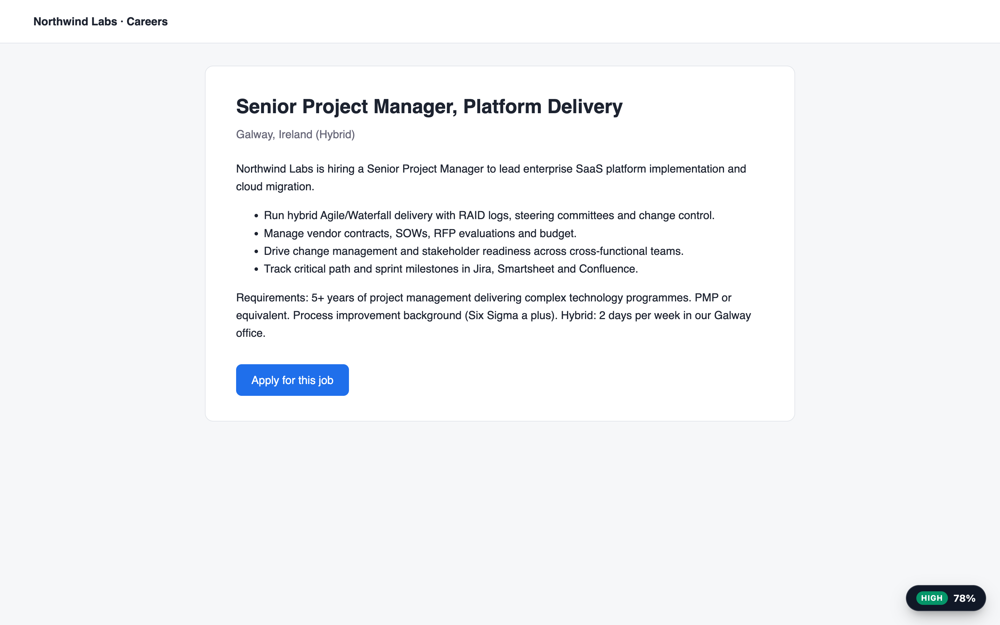

<div align="center">

# Job Fit Overlay

**Stop reading job posts. Know in seconds if they fit.**

A browser badge that scores any job posting against *your* rules, plus a Claude second opinion that uses the exact same brain.

    [](https://buymeacoffee.com/dorianliriano)

</div>

Open a posting on LinkedIn, Indeed, Greenhouse, Lever, Workday, Glassdoor and more. A badge appears with a tier (**HIGH / MID / LOW / SKIP**), a 0-100 match score, and the exact rules that fired: hard excludes, years caps, commute, gaps. Click **Feed to Claude** for a full second opinion. Paste the same posting into Claude chat or Claude Code and you get the same rubric, because every place reads the same files.

```
            ~/.job-fit-brain/   (you write it once)
         profile.md · rules.json · rubric.md
                      │
   ┌──────────────┬───┴──────────┬────────────────┐
 Browser badge   Claude button   Claude Code      Claude chat
 (instant)       (local CLI)     (skill + CLI)    (skill zip)
```

## See it


[Watch the 18-second video](docs/img/demo.mp4)

| A strong fit | Hard gates firing |
|---|---|
|  |  |

Demo postings are invented, scored with the bundled example brain. The badge sits quietly in the corner until you open it:



**Quick start**

```bash
git clone https://github.com/gyos23/job-fit-brain.git
cd job-fit-brain && ./setup.sh
```

Then follow [Setup](#setup-macos-about-10-minutes). The starter brain is an example: you replace it with your own profile and rules, and Claude can interview you to do it.

---

## How you get the same score everywhere

You write your brain once, in `~/.job-fit-brain/`:

| File | What it holds |
|---|---|
| `profile.md` | You: location, targets, pay floor, experience, known gaps |
| `rules.json` | Your standing rules: hard excludes, caps, years limits, plus keyword data for the instant browser triage |
| `rubric.md` | The scoring method Claude follows |

Every surface reads those files:

| Where you score | What it uses |
|---|---|
| Browser overlay badge (instant) | `rules.json` through `engine.js`. Deterministic: the same posting always gives the same number |
| "Feed to Claude" button | `profile.md` + `rules.json` + `rubric.md` (+ any other `.md` in the brain), through your local `claude` CLI |
| Claude Code | The `job-fit-score` skill reads the live brain folder; `cli.js` runs the same engine as the badge |
| Claude chat (claude.ai) | The same skill uploaded as a zip with a snapshot of the brain |

What is identical: the regex gates in `rules.json` and the rubric text. What can differ: Claude also applies rubric caps that need reading, such as pay not stated, commute days, or whether a technical skill is the core of the role. The badge cannot see those, so Claude's tier can sit below the badge's (for example badge HIGH, Claude MID for a posting with no pay). The 0-100 number can also move a few points because it is a judgment. The badge is exact and repeatable; Claude's verdict is the authoritative one.

## Setup (macOS, about 10 minutes)

You need: Chrome or Zen/Firefox, Node 18+, Python 3, and the [Claude Code CLI](https://claude.com/claude-code) signed in. The Claude layer uses your subscription, so there is no API key.

**1. Get the code**
```bash
git clone https://github.com/gyos23/job-fit-brain.git && cd job-fit-overlay
```

**2. Create your brain**
```bash
./setup.sh
```
This copies `brain-template/` to `~/.job-fit-brain/`, builds the extension, registers the Claude host, links the skill into Claude Code, and prints a check. The template is an example for a senior project manager; **it is not you yet**. Fill in your own:

```bash
cd ~/.job-fit-brain && claude "Interview me about my job search, then rewrite profile.md, rules.json and rubric.md for me. Follow docs/BRAIN.md in the cloned repo. Keep the rules.json structure."
```
Then run `./build.sh` in the repo to recompile and re-test. Details: [docs/BRAIN.md](docs/BRAIN.md).

**3. Load the extension**
- Chrome: `chrome://extensions`, turn on Developer mode, Load unpacked, pick this folder.
- Zen/Firefox: run `./build.sh`, then `about:debugging#/runtime/this-firefox`, Load Temporary Add-on, pick `dist/firefox/manifest.json`. (Chrome and Firefox need different background keys, so the build writes a Firefox copy.)

If Chrome shows an extension ID other than `jbljfmamepnilgemekjfbmjchdepaceo`, run `host/install-host.sh <that-id>` and reload the extension.

**4. Use the same brain in Claude chat**
```bash
./pack-skill.sh
```
Upload `dist/job-fit-score.zip` at claude.ai under Settings, Capabilities, Skills. Re-run and re-upload whenever you change the brain. Claude Code needs nothing more: `setup.sh` already linked the skill.

**5. Check it**
- `setup.sh` prints the host check. `contextLoaded` must list `profile.md`, `rules.json` and `rubric.md` with paths and byte sizes, and `contextMissing` must be empty.
- Score one posting in the overlay, with Feed to Claude, and in Claude chat ("score this posting" plus the text). The rules that fired should agree. Claude's tier may be lower than the badge's if the rubric has a cap the badge cannot check; its reply says why.

## Log to a Google Sheet (optional)

The **Log** button writes Claude's verdict to a tab named `Job Applications` and archives the posting text in `JD Archive`. Columns are matched by header text in row 1 (see `buildTrackerRecord` in `engine.js` for the names).

```bash
apps-script/setup-tracker.sh <your-sheet-id>
```
It signs `clasp` in to your Google account, deploys a small web app bound to that one sheet, and stores the URL and token in `~/.job-fit-overlay/tracker.json`. Nothing is pasted into the extension.

## Everyday use

- Edit your brain, then `./build.sh` (recompiles, runs tests, repackages), then reload the extension.
- `echo "<posting text>" | node cli.js --title "Senior PM"` gives the browser triage from the shell.
- Environment: `JOB_FIT_BRAIN` moves the brain folder; `JOB_FIT_CLAUDE` points at the `claude` binary if it is somewhere unusual.

## Reconcile the badge with Claude

Every time you press Feed to Claude, the posting and Claude's verdict are saved to `~/.job-fit-overlay/calibration.jsonl` on your machine. After a handful:

```bash
node calibrate.js
```
It replays those postings through your current rules and prints tier agreement, the average gap per scoring part, and the worst misses with what Claude credited that the badge did not. Add the missed terms to `categories` in your `rules.json`, run `./build.sh`, and run it again to watch the gap close. The badge will stay a bit more conservative than Claude; the aim is the same tier, not the same number.

## Limits

- The installer is macOS only (native messaging paths). The scoring code is portable.
- The Claude button needs the `claude` CLI on the same machine; without it, the overlay copies the posting to your clipboard and opens claude.ai.
- Chat scoring uses a snapshot of the brain. If you forget to re-pack after editing, chat and the extension will disagree.

## Layout

`engine.js` triage engine (all personal data comes from the brain) · `content.js`, `overlay.css` page overlay · `popup.*` toolbar popup · `host/` native messaging host for Claude · `skill/` the Claude skill · `brain-template/` starter brain · `apps-script/` optional sheet logger · `tests/` run by `./build.sh`.

## Support

If this saves you time, you can [buy me a coffee](https://buymeacoffee.com/dorianliriano). Issues and pull requests are welcome.
